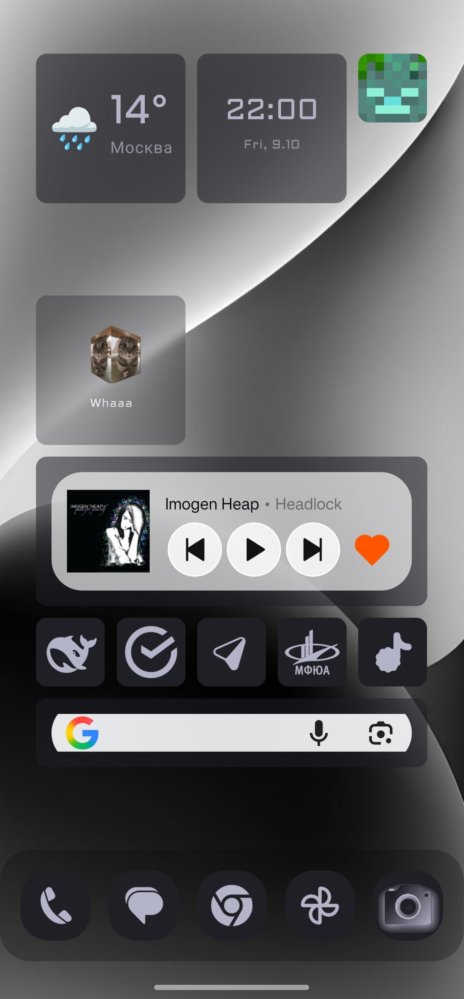
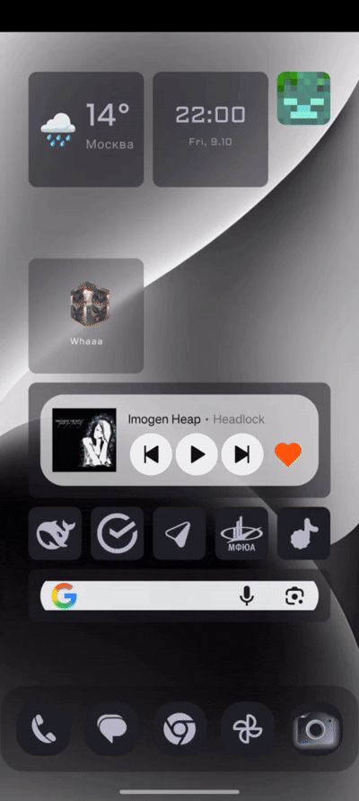
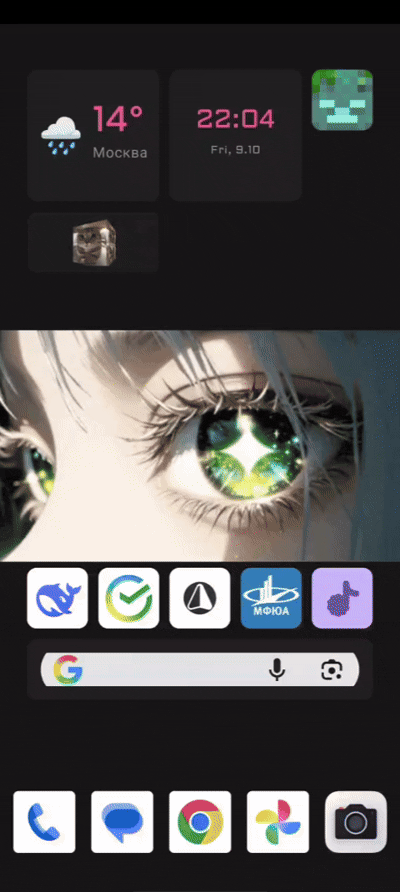

<p align="center">
  
</p>

<h1 align="center">Ethereal Launcher</h1>

<p align="center">
  A tile-based Android launcher that replaces endless horizontal swiping with a single grid and full-screen Spaces.
</p>

<p align="center">
  <a href="https://github.com/Neytron951/Ethereal/releases">
    
  </a>
  <a href="LICENSE.txt">
    
  </a>
  
  
</p>

---

## Why Ethereal

Most Android launchers keep the same paradigm they've had for over a decade: an infinitely wide home screen that you scroll through horizontally, folders nested inside folders, and widgets fighting for whatever space is left.

Ethereal takes a different approach.

Instead of endless pages, everything lives on **one dense grid**. Instead of folders, you get **Spaces** — full screens with their own layouts, widgets, and apps. Tap a Space to enter, tap to leave. No digging through nested folders, no swiping through screens you forgot existed.

The home screen stops being a place you scroll through and becomes a place you actually organize.

One grid. Multiple Spaces. No endless swiping.

---

## Features

### Core

- **Tile-based home screen** — a single grid where everything lives, no horizontal pages
- **Spaces** — folders reimagined as full screens, each with its own layout, widgets, and apps
- **Drag and drop** — rearrange tiles freely with automatic collision handling
- **System widgets** — place real Android widgets on the grid via AppWidgetHost

### Appearance

- **29 color palettes** — from AMOLED black to Catppuccin, Dracula, Nord, and more
- **16 font families** — system default plus bundled custom fonts
- **Frosted glass UI** — adjustable panel opacity and blur
- **Custom icon shapes** — circle, square, squircle, cut corner
- **Icon packs** — compatible ADW, Nova, Apex, and Holo packs
- **Themed icons** — tint app icons in your theme colors (Material You style)
- **Font size scaling** for the whole launcher

### Built-in widgets

- **Clock** — time and date, localized
- **Weather** — live data from Open-Meteo, IP-based or manual city
- **Audio spectrum** — eight live frequency bands from Android's audio visualizer (requires microphone permission; analyzes playback without recording or storing it; device support varies)
- **E-Search** — quick app search accessible from a tile

### Dock

- Up to 8 apps in the Dock
- Adjustable icon size, bottom padding, and shape
- Optional icon background frame
- Scrollable mode for many icons
- Themed icons support

### E-Search

- Swipe up from the home screen to open
- Long-press an app for system app info or uninstall actions
- Frosted glass overlay with adjustable blur
- Adaptive app sorting by usage frequency
- Cascade animation on open

### Wallpaper

- Pick from gallery or use built-in wallpapers
- Apply to home screen, lock screen, or everywhere
- Four scaling modes: Crop, Fit, Stretch, Center

### Other

- Multi-language: English and Russian
- Onboarding wizard for first-time setup
- Optional anonymous analytics (can be disabled at any time)
- In-app update notifications via GitHub Releases
- Settings backup includes layouts, Spaces, saved wallpapers, and custom tile images

---

## Screenshots

<p align="center">
  
  
  
</p>

<p align="center">
  <sub><b>Home</b> · <b>Spaces</b> · <b>E-Search</b></sub>
</p>

<p align="center">
  
  
  
</p>

<p align="center">
  <sub><b>Theme switching</b> · <b>Frosted glass</b> · <b>Onboarding</b></sub>
</p>
---

## Tech Stack

- **Kotlin** — 100% Kotlin codebase
- **Jetpack Compose** — declarative UI, Material 3
- **WorkManager** — background update checks
- **Coil** — image loading (GIF and adaptive icon support)
- **Firebase Analytics** — optional, anonymous, opt-in
- **GitHub Releases API** — in-app update notifications

---

## Requirements

- Android 8.1 (API 27) or higher
- No Google Play Services required (except for optional analytics)

---

## Building

Clone the repository and build with Gradle:

```bash
git clone https://github.com/Neytron951/Ethereal.git
cd Ethereal
./gradlew assembleDebug
```

The debug APK will be at `app/build/outputs/apk/debug/app-debug.apk`.

For a release build:

```bash
./gradlew assembleRelease
```

### Firebase configuration

Ethereal uses Firebase Analytics for optional, anonymous usage statistics. The `google-services.json` file is not included in this repository.

If you want analytics to work in your own build, place your own `google-services.json` in the `app/` directory. Otherwise, the analytics module will be silently disabled — the launcher works fine without it.

---

## Installation

1. Download the latest APK from the [Releases](https://github.com/Neytron951/Ethereal/releases) page.
2. Allow installation from unknown sources if prompted.
3. Install and open the app.
4. Press the Home button and select Ethereal as your default launcher.

---

## Update System

Ethereal checks for updates automatically in the background (once per day) via the GitHub Releases API. When a new version is available, a notification appears in **Settings → About**.

You can also check manually: **Settings → About → Check for updates**.

---

## Privacy

Ethereal collects minimal, anonymous analytics to improve the launcher:

- Which themes and fonts are popular
- Which features are used (edit mode, Spaces, widgets, search)
- Onboarding completion rate

**What we do NOT collect:**

- App names or package names
- Search queries
- Location data
- Device model or unique identifiers

Analytics can be disabled at any time in **Settings → About → Help improve Ethereal**.

---

## License

This project is licensed under the **GNU General Public License v3.0**.
See [LICENSE.txt](LICENSE.txt) for details.

---

## Author

Developed by [Neytron951](https://github.com/Neytron951).