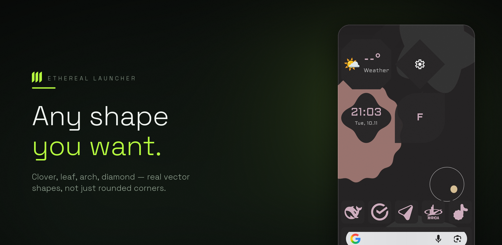
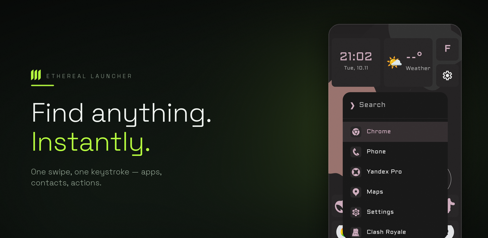
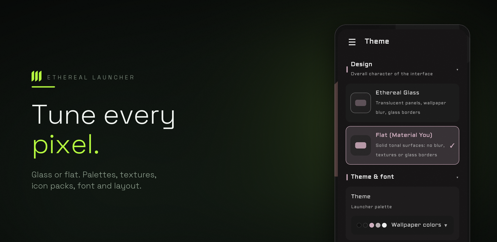
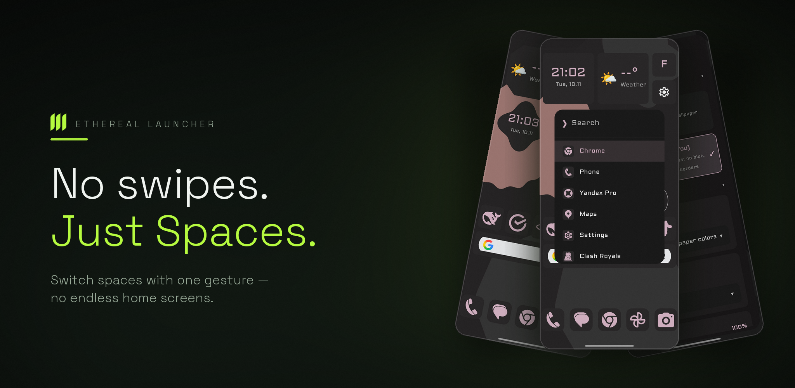

<p align="center">
  
</p>

<h1 align="center">Ethereal Launcher</h1>

<p align="center">
  A tile-based Android launcher replacing horizontal swiping with a single grid and full-screen Spaces.
</p>

<p align="center">
  <a href="https://github.com/Neytron951/Ethereal/releases">
    
  </a>
  <a href="LICENSE.txt">
    
  </a>
  
  
</p>

---

## Why Ethereal

Most Android launchers keep the same paradigm they've had for over a decade: an infinitely wide home screen you scroll through horizontally, folders nested inside folders, and widgets fighting for whatever space is left.

Ethereal takes a different approach.

Instead of endless pages, everything lives on **one dense grid**. Instead of folders, you get **Spaces** — full screens with their own layouts, widgets, and apps. Spaces can contain other Spaces, so a "Work" space can hold "Docs" and "Meetings" without a single nested folder.

And instead of guessing where things are, you can **pinch out** on the home screen to open the **Spaces overview**: every space as a card on an infinite canvas, connected by threads that show who belongs to whom. Drag the cards around, tap one to jump straight in.

One grid. Multiple Spaces. No endless swiping.

---

## Showcase

<p align="center">
  
  <br><br>
  
  <br><br>
  
  <br><br>
  
</p>

---

## Key Features

| Feature | Description |
| :--- | :--- |
| **Tile Grid** | Drag-and-drop tiles with auto-collision, resizing, 1×1 to multi-cell layouts, and a catalog of tile shapes. |
| **Spaces** | Full-screen pages for grouping apps, widgets and layouts — nestable, with their own grid and background. |
| **Spaces Overview** | Pinch out on home to see the whole tree: cards on a canvas, threads between parent and child, drag-to-arrange, long-press to open or delete. |
| **Space Presets** | Create a space pre-filled from 11 presets (Games, Tools, Social, Media, Photos, Work, News, Travel, Contacts, All apps). Overflow goes into a nested "More" space, so no app is lost. |
| **E-Search** | Fast app search with usage-based sorting, four layouts (default, categories, grid, compact), and a process-wide icon cache. |
| **Customization** | 30 color palettes, 15 fonts, frosted-glass blur, flat / Material You panels, per-tile styling and third-party icon packs. |
| **Dock** | Scrollable dock with its own size, shape, icon-background and blur settings. Custom opacity is on by default at 0% — icons float. |
| **Built-in Widgets** | Live weather (Open-Meteo), audio visualizer, clock, and full AppWidgetHost support. |
| **Onboarding** | Six steps: theme, font, system setup, dock, grid size, and a starter layout (Empty / Minimal / Everyday) with a hand-picked app selection. |
| **Backup & Restore** | One JSON file with settings, spaces, layouts, wallpapers and assets. Positions on the overview canvas are preserved. |
| **Update Center** | Checks GitHub releases, shows the changelog with full release-notes rendering, and links to the download. |

---

## Gestures

| Action | Result |
| :--- | :--- |
| Swipe up on home | Open **E-Search** |
| Pinch in on home | Open the **Spaces overview** |
| In the overview: one finger on empty space | Pan the canvas |
| In the overview: one finger on a card | Move that card |
| In the overview: two fingers | Pan and zoom |
| In the overview: long-press a card | Context menu — open or delete the space |
| Tap a Space tile | Enter the space |

---

## Spaces, Presets and the Canvas

- A Space lives inside a layout as a tile, so the hierarchy is just the tiles themselves — no hidden registry to get out of sync.
- The overview arranges children in a ring around their parent. Positions you set by dragging are remembered and never auto-overwritten.
- Deleting a Space deletes its whole subtree — devices' widgets, images, layouts and metadata — and removes the portal tile from its parent.
- Spaces with no parent tile are grey **unlinked**: visible, not deleted, and removable from the overview whenever you feel like it.

---

## Installation & Setup

1. Download the latest APK from [Releases](https://github.com/Neytron951/Ethereal/releases).
2. Install the APK and press **Home**.
3. Select **Ethereal** as your default launcher.

The first launch walks you through theme, font, dock, grid size and a starter layout. Everything can be changed later in Settings.

---

## Tech Stack & Requirements

- **Requirements:** Android 8.1+ (API 27+), target SDK 37. No Google Play Services required.
- **Stack:** 100% Kotlin, Jetpack Compose (Material 3), Coil, WorkManager, Firebase Analytics/Crashlytics (optional, off by default).
- **Toolchain:** AGP 9.4.1, Kotlin 2.2.10, Gradle 9.6.0.

```bash
# Build Debug APK
git clone https://github.com/Neytron951/Ethereal.git
cd Ethereal
./gradlew assembleDebug
```

---

## License & Privacy

- **License:** [GPL-3.0 License](LICENSE.txt).
- **Privacy:** Optional, anonymous analytics (can be disabled anytime in Settings). No search history, package names, or location data collected. Backups are plain JSON files that never leave your device unless you share them.
